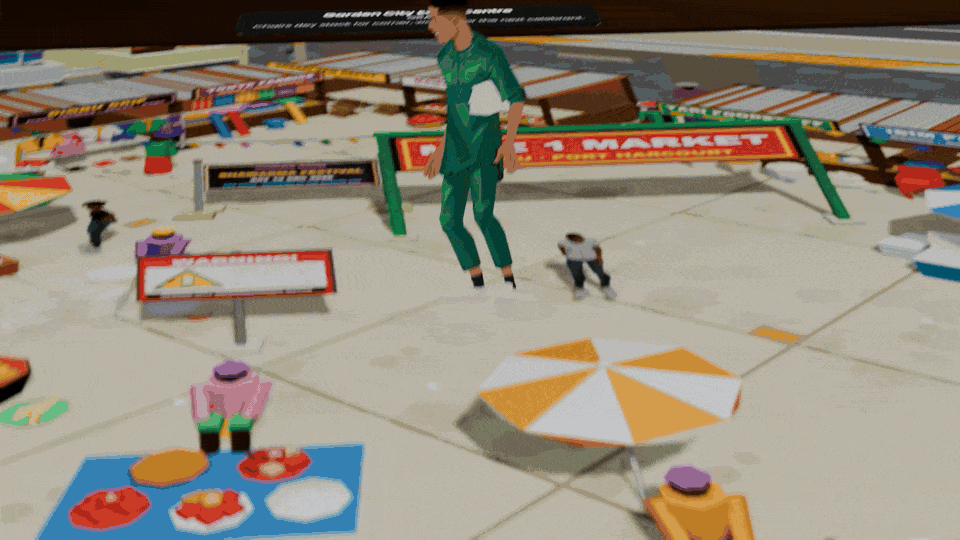
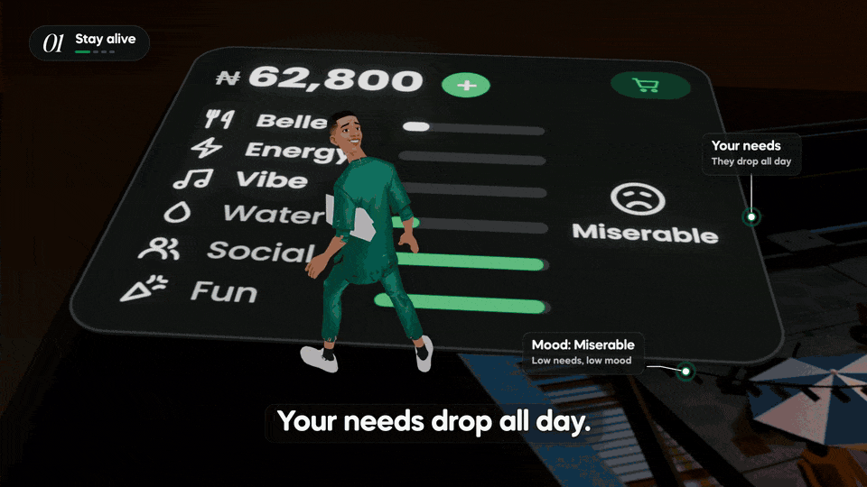
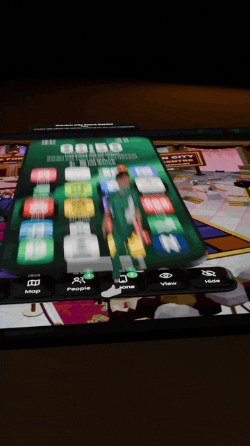
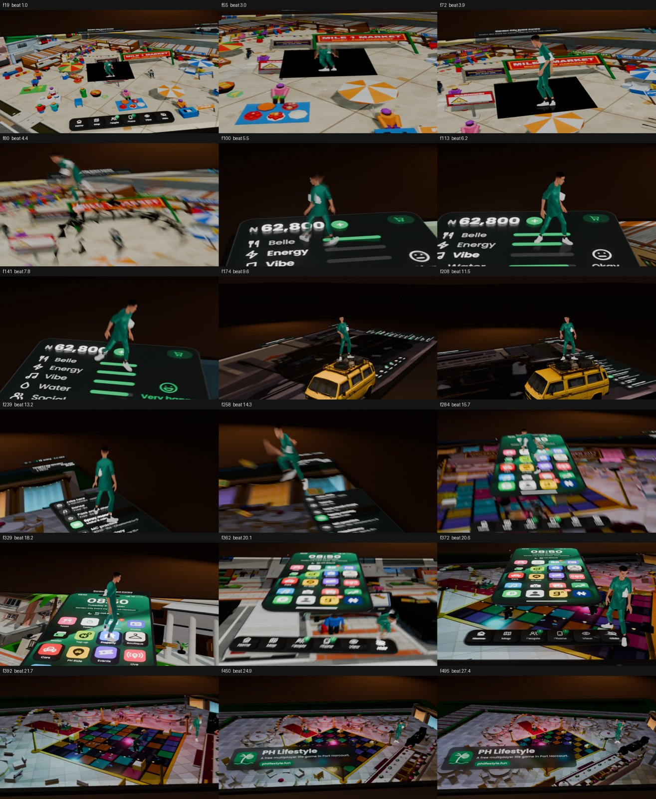
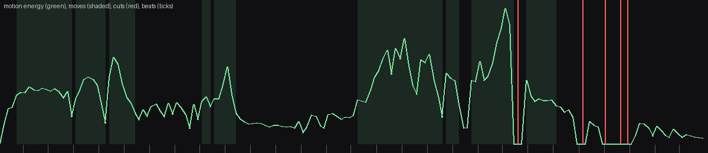
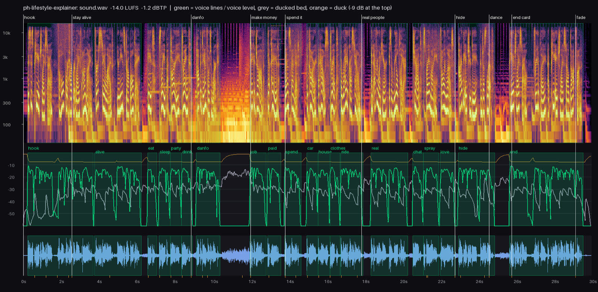

# motion-studio

A Claude Code skill for making short motion films in code: product promos,
launch videos, explainers, UI walkthroughs. No After Effects, no templates.

You drop in a reference you like (a video, a GIF, a link, a few stills) and
point it at your product. It measures the reference, writes down the look as
numbers, proves it can match it on a short test, then builds the film from
your real screens. Every frame comes out of a script, so any shot can be
re-rendered on its own and the whole thing can be rebuilt from source.



## Examples

These were made with the skill for [PH Lifestyle](https://www.phlifestyle.fun),
a multiplayer life game set in Port Harcourt that I build. Nothing on screen
is mocked up: the needs card, the jobs list and the phone were captured from
the live game's HUD, and the world is footage recorded in the game.

**Hide the HUD** (16.8 s, 3D, above). The game's UI is cut into floating
slabs in Blender and a player hops across them: the needs card fills as he
lands on it, a danfo carries him to the jobs list, the phone home screen
lifts away into the party hall. Music and every hop sound are synthesized
from the same timeline.
[Watch with sound (16:9)](media/films/hide-the-hud-16x9.mp4)

**Explainer** (30 s, hybrid). The same world with a 2D layer on top: chapter
chips, captions with accent words, callouts pinned to points in the 3D scene,
a local voice-over and a music bed that ducks under it.
[Watch with sound](media/films/explainer-16x9.mp4)



<table>
<tr>
<td width="300"></td>
<td>

**9:16 is its own composition.** The vertical film isn't a crop of the wide
one. It has its own camera path with a tighter follow, wider framing on the
panels and an end card stacked for a phone screen.

[Watch with sound (9:16)](media/films/hide-the-hud-9x16.mp4)

</td>
</tr>
</table>

### What the checks look like

The skill reviews its own output before you see it. A few of the sheets it
made along the way:



18 stills before the full render. The first three have a black square under
the player. It was caught here and fixed before the long render, which is the
point of looking at cheap frames first.



`analyse-inspo.py` pointed at the finished Hide the HUD film: motion energy
over time, detected moves shaded, cuts in red. It reads one long 12.3 s camera
move, a hard cut, then the end card building up. Normally you run it on your
reference; here it's on our own film so you can see the output.
More: [contact sheet](media/analysis/contact-sheet.jpg),
[shots sheet](media/analysis/shots-sheet.jpg).



The explainer's sound check: -14.0 LUFS integrated, -1.2 dBTP peak, each
voice line against the ducked bed.

## What it actually does

- **Measures the reference.** Shot lengths, cut rhythm, motion energy, palette,
  loudness. `analyse-inspo.py` writes the numbers to `analysis.md` along with
  contact sheets, and `look.py step` lays out a move frame by frame so you can
  read its easing and overshoot.
- **Writes a look recipe.** `style-guide.md`, where every value (hex, font
  size, curve, stagger) points at the frame it came from.
- **Tests the look before building.** A 3 to 5 second test is rendered and
  placed side by side with the reference. You approve it or say what's off.
- **Runs everything off one timeline.** `timeline.py` holds the beats, the UI
  layout in pixels and every event. Picture, captions and sound all read it,
  so a click sound lands on the frame the button is pressed.
- **Renders in 2D, 3D or both.** 2D is an HTML page with a
  `renderFrame(f)` function, rendered by puppeteer. 3D is a Blender scene built
  from Python. Hybrid puts a 2D caption layer over a 3D world.
- **Makes its own sound.** Music and effects are synthesized with numpy and
  scipy from the timeline. Voice-over is optional and runs locally (Kokoro).
- **Reviews itself.** Stills and contact sheets before the full render, then
  the three worst defects are written down with timestamps, fixed and
  re-rendered before you see the final cut.

It uses your real product only. If a screen, number or logo is missing it
stops and asks instead of drawing a fake one.

## Install

```sh
git clone https://github.com/DanielDerefaka/motion-studio ~/.claude/skills/motion-studio
```

The skill's paths assume that folder, so keep it there. Then check what your
machine has:

```sh
sh ~/.claude/skills/motion-studio/scripts/check.sh
```

| Tool | Needed for |
|---|---|
| Node 20+ and puppeteer | 2D rendering, UI capture (`npm i puppeteer` per studio) |
| Python 3 | timeline, analysis, sound (the skill makes a venv with numpy, scipy, soundfile, pillow) |
| ffmpeg | all video work |
| Blender 5.x | 3D and hybrid films only (tested on 5.2) |
| yt-dlp | optional, to pull a reference from a link |

No Blender is fine. Most looks are 2D and the skill will say when it's
falling back.

## Use

In Claude Code, run `/motion-studio`, or just ask for a promo or explainer
and attach a reference. It works through ten steps and stops three times for
you: after the look test, after the shot list, and on the final film.

1. **Intake.** Fills a brief: the one sentence the viewer should remember,
   audience, length, formats, the real product facts.
2. **Scaffold.** `new-studio.sh <name> <2d|3d|hybrid>` makes the folder.
3. **Read the reference.** Measure it, frame-step the signature moves, write
   the recipe.
4. **Look test.** Side-by-side with the reference. *You approve.*
5. **Assets, shot list, timeline.** Real screens captured, beats on the BPM
   grid, one motion rule per kind of object. *You approve.*
6. **Build.** The 2D composition or the Blender scene, plus voice if any.
7. **Stills.** About 18, checked against the recipe.
8. **Rough cut.** Full render, sound, encode, contact sheet.
9. **Fix the three worst defects.** Timestamped, fixed, only those frames
   re-rendered.
10. **Formats.** 9:16 and 1:1 are laid out again, never cropped. Posters,
    sheets and a README with what still needs a human eye.

A studio keeps its state in files (`brief.md`, `style-guide.md`,
`shotlist.md`, `reviews/`, `out/`), so you can stop anywhere and run
`/motion-studio` in the same folder later to pick up from the last step.

### The measuring tools on their own

`analyse-inspo.py` and `look.py` don't need Claude. They need ffmpeg, numpy
and pillow.

```sh
python3 scripts/analyse-inspo.py reference.mp4 analysis/       # numbers + sheets
python3 scripts/look.py step reference.mp4 1.2 1.8             # every frame of one move
python3 scripts/look.py compare reference.mp4 mine.mp4 --n=8   # side by side
```

## What's in the repo

```
SKILL.md                 the steps Claude follows
reference/
  inspo.md               gathering, measuring and frame-stepping a reference
  method.md              layers, beats, motion rules, review checklist, gates
  pipeline.md            the three branches and every command in order
  craft.md               fonts, sizes, safe areas, voice, mix
  prompt-pack.md         prompt blocks for a 3D UI film, notes, hit table
  lessons.md             what went wrong on real films and the fix
scripts/
  analyse-inspo.py       measures a reference
  look.py                frame-step a move, compare two films
  new-studio.sh          scaffolds a studio folder
  check.sh               reports which tools are installed
templates/
  timeline.py            the single timeline
  2d/                    renderFrame composition, motion helpers, puppeteer renderer
  blender/               scene kit, stills and render scripts
  capture/               snapshot a live page, cut UI slabs, record footage
  sound/                 synth and mix from the timeline
  voice/                 local Kokoro voice-over
  docs/                  brief, shot list, style guide
example/ph-lifestyle/    two finished films with their source and review sheets
media/                   the GIFs, films and sheets used in this README
```

## Limits

- Built and used on macOS with Apple silicon. The scripts are plain sh,
  Python and Node, but Linux and Windows haven't been tested.
- 3D is slow. EEVEE runs about 3 s a frame at 1080p, Cycles 40 to 60 s.
  Expect around 25 minutes per format for a 15 s EEVEE film.
- It takes the feel of a reference, not its contents. Logos, footage, music
  and copy from the reference are never used.
- No fonts ship with it. The skill downloads free ones that fit the recipe,
  or uses the ones you give it.
- The contact sheets catch a lot, but the final call on the look and the
  sound is yours.

## Credits

The idea of splitting a film into layers with review gates comes from rari's
"Motion Engineering" write-up ([@0xwhrrari](https://x.com/0xwhrrari)). The
approach of rebuilding real UI as HTML and driving a 3D film from one
timeline was inspired by Clawd Motion Lab's "No After Effects" prompt.
Voice-over uses [kokoro-onnx](https://github.com/thewh1teagle/kokoro-onnx).

## License

The code and docs are MIT, see [LICENSE](LICENSE). The films, GIFs and
screenshots in `media/` and `example/` show PH Lifestyle and are here as
examples only; please don't reuse them.
